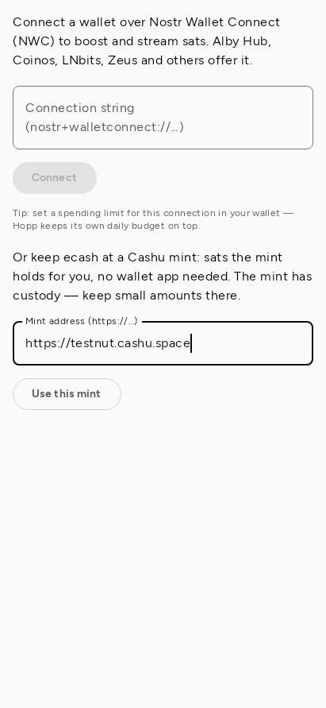
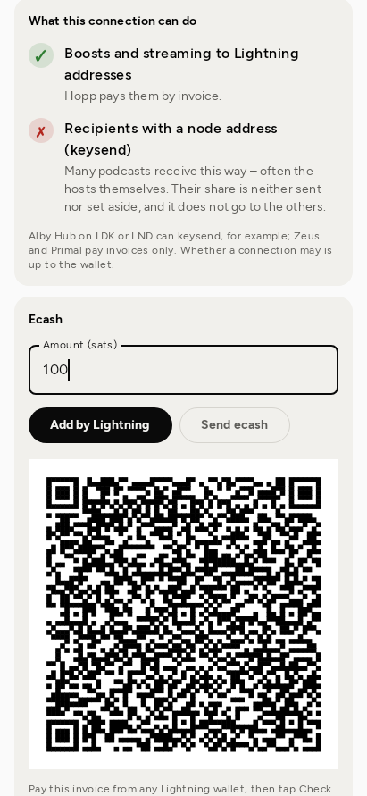
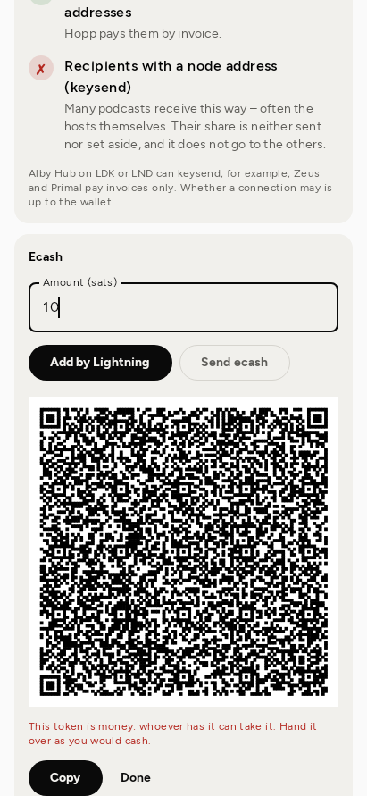
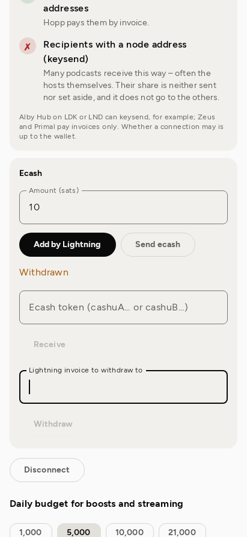

# Cashu ecash wallet for Hopp — Nut November 2026

[Hopp](https://gitlab.com/nodesignal/hopp) is a Value4Value podcast app by Nodesignal (Kotlin
Multiplatform: Android, iOS, web). Until now a listener needed a wallet that speaks NWC to boost or
stream sats. This branch adds a **Cashu ecash wallet inside the app**: pick a mint, top up with one
Lightning invoice from any wallet, and boost Lightning-address podcasts from the ecash.

Hopp's own plan already lists it: ADR 0005 puts a "built-in Cashu wallet" in Phase 3, and
Nodesignal suggested "Add Cashu to Hopp" for this hackathon.

- Code: https://github.com/Rabari9999/hopp-cashu, branch `feat/cashu-wallet`
- Design: [`docs/adr/0026-cashu-wallet.md`](docs/adr/0026-cashu-wallet.md)
- Track: Value4Value

## What existed before November, and what is new

**Before:** all of Hopp. The branch starts from upstream `main` at `a930fc0` (2026-11-13), which
already had the NWC and WebLN wallets, the payment router, the daily budget, the payment journal
and `ProvenWallet`.

**Added in November:** 11 commits from 2026-11-14 to 2026-11-18, 35 files, about 3,050 lines.
Everything under `value/cashu/`, the ecash page, its strings in all six languages, the tests and
ADR 0026. Outside `value/cashu/` the changes are small: point operations added to Hopp's
secp256k1 wrapper, an ecash mode in `WalletRepository`, and the page wiring.

```
git log --oneline a930fc0..feat/cashu-wallet
```

## Demo

The real app page against the public test mint `testnut.cashu.space`. The mint's Lightning side is
simulated, so its invoices pay themselves.

| | |
|---|---|
|  |  |
| Choose a mint. Nothing contacts it before this tap. | Add 100 sats: a Lightning invoice to pay from any wallet, then **Check**. |
|  |  |
| Send 10 sats as a `cashuB` token, with a warning that the token is money. | Receive it back (9 sats after the mint's fee), then withdraw 20 to an invoice. 77 sats left. |

The screenshots are drawn by `EcashDemoShotsTest`, which drives the real page against a real mint
(see Tests).

## How it fits into Hopp

`CashuWallet` implements Hopp's existing `WalletClient` interface, the same one NWC and WebLN use.
So boosts, streaming, the daily budget, the spending lock, the payment journal and `ProvenWallet`'s
preimage check all apply without changes. A mint cannot pay keysend, so keysend recipients are
skipped, exactly as for an NWC wallet without `pay_keysend`.

The protocol is written in Kotlin on top of the secp256k1 libraries Hopp already ships (ACINQ on
Android, iOS and JVM; noble on the web). No new native library.

| NUT | What |
|---|---|
| 00 | Blind signatures (hash_to_curve, blind, unblind); tokens `cashuA` and `cashuB` (CBOR) |
| 01, 02 | Keys and keysets; keyset ids v1 and v2 checked against the keys; input fees |
| 03 | Swap: receive a token, make one to send |
| 04 | Mint: top up by Lightning |
| 05 | Melt: pay an invoice, including invoices without an amount |
| 06 | Mint info |
| 07 | Proof state, to recover from a lost request |
| 08 | Blank outputs for fee-reserve change |
| 09 | Restore the signatures of an answer that was lost |
| 12 | DLEQ proof checked on every signature |

## Proofs are money

- **Stored as secrets.** Proofs live in the Android Keystore or iOS Keychain, as one entry, never in
  the database, sync or backup.
- **Journal first.** Every swap, mint and melt is written down, with its blinding factors, before the
  request leaves. A dropped connection is recovered on the next call (quote state, NUT-09, NUT-07).
- **Unknown, not failed.** A payment with no clear answer is reported as unknown, as Hopp does for
  NWC. It is never retried as if it had failed.
- **Nothing unchecked comes in.** Keys must match their keyset id. Every signature must have a valid
  DLEQ proof, and the DLEQ's `r` is removed before a proof goes back to the mint.
- **https only** (or an onion address). Disconnecting is refused while the wallet holds sats.
- **Privacy.** Hopp contacts a mint only after the listener taps "Use this mint" (ADR 0015).

## Tests

54 tests run offline:

| Test | What | Count |
|---|---|---|
| `BdhkeVectorsTest` | NUT-00 and NUT-12 test vectors | 9 |
| `CashuTokenTest` | Token v3 and v4 vectors | 9 |
| `MintClientTest` | API models, keyset id v1 and v2 | 7 |
| `CoinsTest` | Coin selection and fees | 9 |
| `CashuWalletTest` | Against `FakeMint`, which signs with real DLEQ proofs and can refuse, pend, fail or drop the connection after doing the work | 13 |
| `ValueServiceTest` | A boost paid from ecash; ecash kept like a connection | 2 |
| `EcashWalletViewModelTest` | The page's actions | 3 |
| `EcashWalletPageTest` | Robolectric: the mint is not contacted before the tap; a wallet holding sats is not disconnected | 2 |

```
./gradlew :shared:jvmTest :androidApp:testFossDebugUnitTest
```

Two tests use a real mint and are off unless `HOPP_LIVE_MINT` is set, so CI stays offline:

```
HOPP_LIVE_MINT=https://testnut.cashu.space ./gradlew :shared:jvmTest --tests '*LiveMintTest'
HOPP_LIVE_MINT=https://testnut.cashu.space ./gradlew :androidApp:testFossDebugUnitTest --tests '*EcashDemoShotsTest'
```

Checked on 2026-11-18 against testnut (cdk-mintd 0.18.1, v2 keysets, input fee 100 ppk): minting,
sending, receiving and paying an invoice all work, with fees as expected. The web build compiles with
the ecash code; the wallet itself is apps only, because Hopp keeps no wallet in the browser.

## Known limits

- **testnut sends no preimage for invoices it settles itself.** Hopp's `ProvenWallet` only counts a
  payment as paid when the preimage matches the payment hash. So a boost to an invoice issued by
  testnut is recorded as "unknown", even though the sats were spent. A mint paying over real
  Lightning is expected to return the preimage, but I could not test one without real sats. I kept
  Hopp's rule as it is; whether a mint's `PAID` may stand in for the preimage is the maintainer's
  call (ADR 0026).
- One mint at a time. No keysend.
- No seed backup (NUT-13) yet, so a lost phone loses its ecash.
- Not done: nutzaps (NIP-61), payment requests (NUT-18), locked tokens (NUT-10/11).

## How it was made

Built with a coding agent (Claude Code), as the hackathon rules encourage. Every change follows
Hopp's CONTRIBUTING rules: tests, strings in every complete language, an ADR, and no network contact
without a tap.
I reviewed each part of the implementation with the agent, ran the test suites against a live testnut mint locally on my Mac, and gained a practical understanding of how Cashu blind signatures and proof stores work.

## License

MIT, like Hopp.
