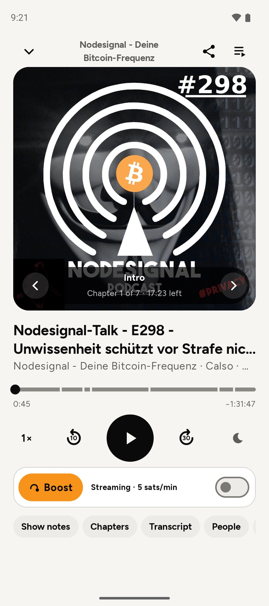
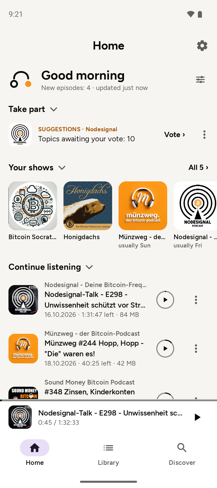
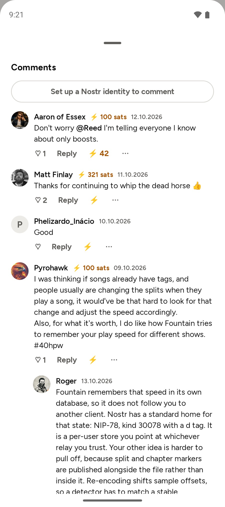
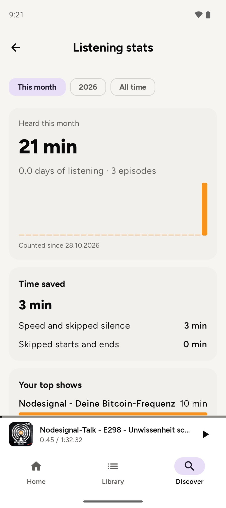

<div align="center">


# Hopp

**Honest open podcast player**

A podcast player for every podcast, built for Podcasting 2.0 and value for value.
No account, no tracking, no server of its own.

[Website](https://hopp.sovereigncast.space) ·
[Get Hopp](#get-hopp) ·
[Changelog](CHANGELOG.md) ·
[Deutsch](CHANGELOG.de.md)






</div>

## What Hopp is

Connect your own Lightning wallet and boost the shows you love, or stream sats
while you listen – Hopp never holds your sats and takes no cut. With an
optional Nostr identity you comment on episodes and keep your devices in sync,
encrypted.

Hopp is the listener-side companion of [Sovereigncast](https://sovereigncast.space),
the self-hosted podcast platform: for a show run on a Sovereigncast instance,
Hopp adds its community – Release Boosting, Boost2Unlock, topic suggestions and
votes, top boosts – on top of the player.

## Features

**Listening**
- ✅ Up next, downloads on Wi-Fi, sleep timer, skip silence, your own skip intervals
- ✅ Speed, intro and outro skipping for each show
- ✅ Chapters with pictures, transcripts that read along, people, clips
- ✅ Listening statistics, home screen widget, Android Auto

**Value for value**
- ✅ Your own Lightning wallet over Nostr Wallet Connect (NWC) – no built-in wallet
- ✅ Boosts, quick boost from the lock screen, streaming sats per minute
- ✅ A daily budget you set; 100 % to the podcasters

**Nostr**
- ✅ Comments on every episode, Fountain's included – write, like, zap
- ✅ Encrypted sync between your devices, no Hopp server

**Discover**
- ✅ Podcast Index search, categories, your shows' recommendations, OPML import and export

**Privacy**
- ✅ Hopp collects nothing; a privacy page shows who sees what when you listen

Phones and tablets, light and dark, English and German.

## Get Hopp

| Platform | Where |
|---|---|
| Android | [Zapstore](https://zapstore.dev/apps/space.sovereigncast.hopp) · [GitLab releases](https://gitlab.com/nodesignal/hopp/-/releases) (updates with [Obtainium](https://github.com/ImranR98/Obtainium)) · F-Droid (in review) |
| iPhone, iPad | AltStore PAL (EU) – in preparation |

## Build it yourself

Needs JDK 21 and the Android SDK (`local.properties`: `sdk.dir=…`).

```bash
./gradlew :shared:jvmTest                     # shared core tests
./gradlew :androidApp:testFossDebugUnitTest   # the app on Android, no device
./gradlew :androidApp:assembleFossDebug       # an APK
```

iOS needs a Mac with Xcode: [docs/ios-release.md](docs/ios-release.md).

## Documentation

- [Architecture decisions](docs/adr/) – [ADR 0018](docs/adr/0018-phase-plan.md) is the phase plan
- [Podcasting 2.0 feature matrix](docs/feature-matrix.md)
- [Community testing](docs/community-testing.md)
- [Open questions](docs/open-questions.md)
- [Brand and logo](docs/brand/)

## Contributing

Merge requests from forks are welcome – see [CONTRIBUTING.md](CONTRIBUTING.md).

## License

MIT – see [LICENSE](LICENSE).
